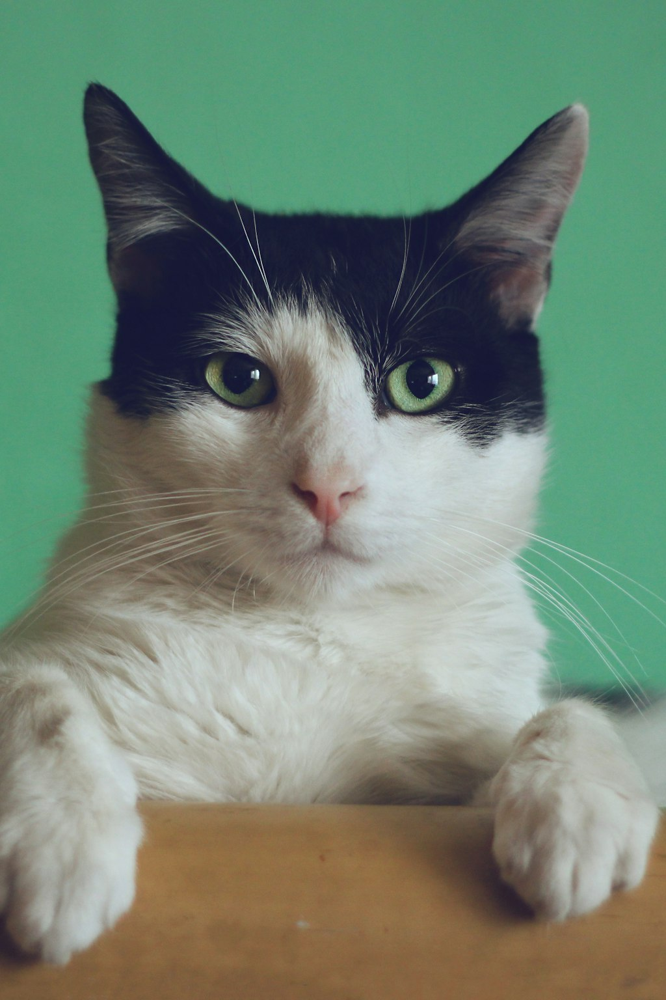

巷口有一面旧墙，不知哪年被谁漆成了绿色，漆色不均，深一块浅一块，像一块用旧了的幕布。猫就住在幕布前面：一只黑白花的猫，脸圆，眼睛是青绿的，和墙色几乎同族。

第一次见它，它正把两只前爪搭在墙根的木沿上，端正地坐着，像出席什么仪式。我蹲下来举相机，它不躲，也不凑近，只是看着镜头，眼神里有一种"拍可以，别动手"的克制。

后来我常带一小袋猫粮路过。它认得脚步声，却从不迎出来，只把尾巴尖轻轻摆一下，算是打招呼。巷子里的人都说它是"有编制的猫"：修车铺给它留纸箱，面馆给它留鱼汤，它则负责在每天傍晚准时坐回绿墙前，让整条巷子显得有名有姓。

猫不解释自己为什么住在这里。它只是坐着，把一面普通的旧墙坐成了巷子的门牌。

> 有些地标不是建筑，是一只猫肯不肯天天坐在同一个地方。

今晚路过，它又在。绿墙、木沿、青绿的眼睛，一切如常。我按下快门，它眨了一下眼，算是签了名。