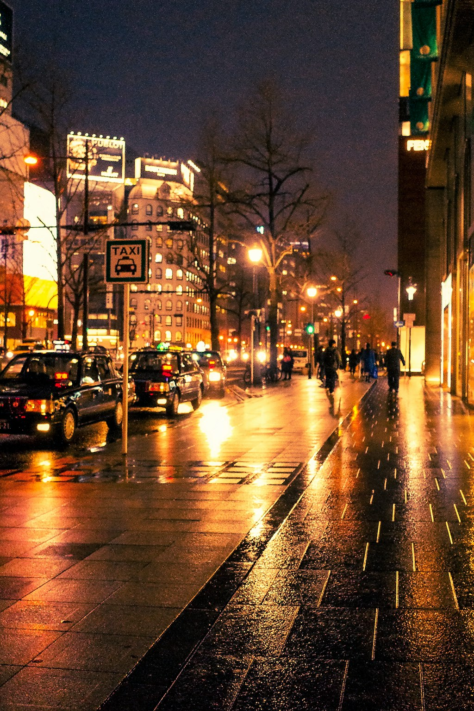

雨是从傍晚开始下的。起初只是细丝，斜斜地掠过路灯，后来索性密成一张网，把整条街罩进去。出租车亮着顶灯慢慢滑过积水，霓虹的倒影被车轮碾碎，又很快拼回来，像谁在水面上反复练习一幅画。

我撑着伞走到街角那家便利店。玻璃门上的雨珠把店内的灯光揉成一团暖黄，推门进去，风铃轻响，关东煮的蒸汽从柜台后面缓缓升腾。货架整整齐齐，罐装咖啡按颜色排成一列，收银台后的老板抬头笑了笑，又低头去理他的报纸。

靠窗的位置有一把高脚凳。我点了一杯热咖啡坐下，看窗外的雨丝斜斜划过玻璃。远处路灯昏黄，整座城市在雨夜里安静下来，时间仿佛慢了下来，只有键盘声和雨声在空房间里轻轻回荡——当然，键盘声是我的，雨声是城市的。

便利店不打烊，雨也不停。我们各自忙着各自的事，互不打扰，又彼此陪伴。这大概就是城市里最便宜也最奢侈的一种客厅：亮着灯，暖着手，谁都可以进来坐一会儿。

---

离开时雨小了些。伞尖滴着水，我在门口回头看了一眼：玻璃门里的暖光落在湿漉漉的人行道上，拉出一条细长的光带，一直铺到我脚边。
